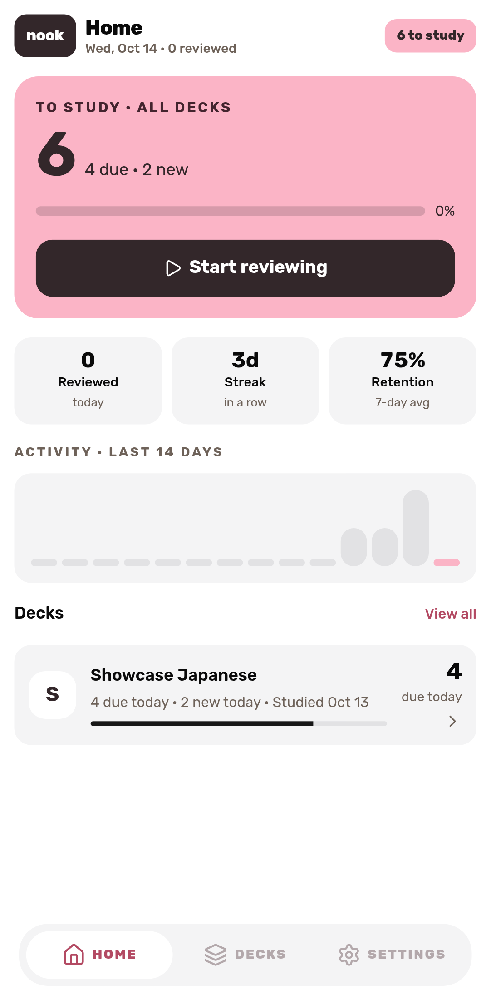
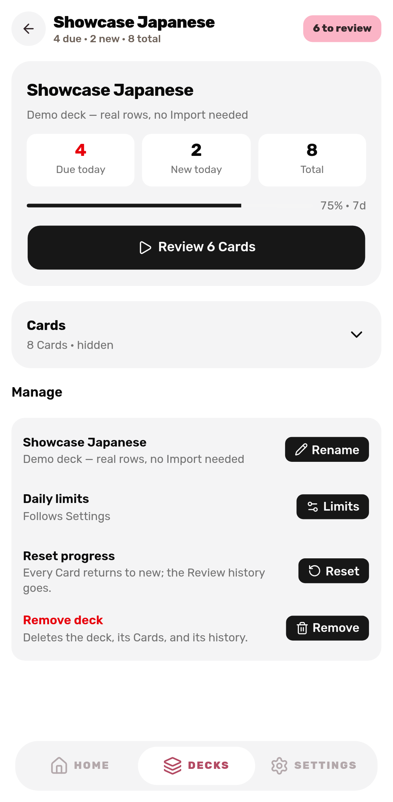
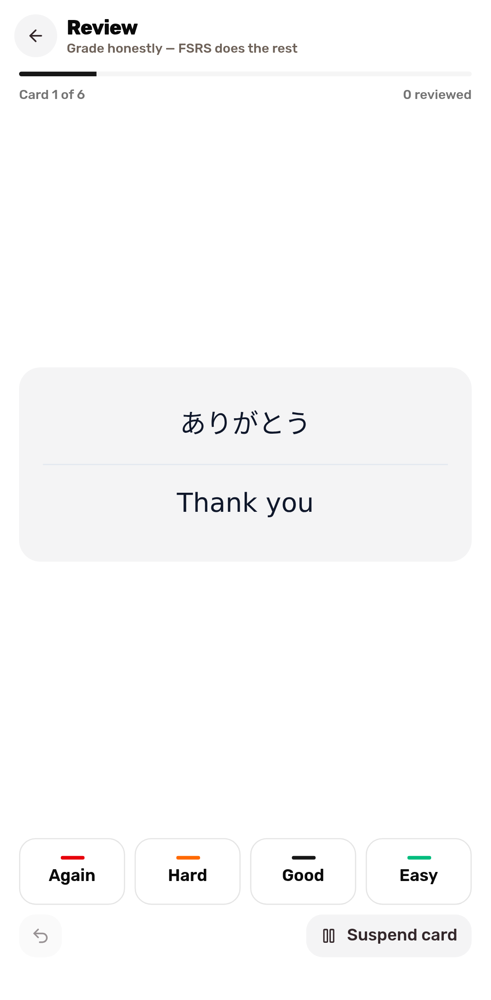

<h1 align="center">
   nook
</h1>

nook is a self-hosted, Android-first spaced repetition app. Import an Anki
deck, then review on your phone or desktop—with or without an internet
connection. nook is an installable progressive web app (PWA) and uses FSRS-6
to schedule reviews.

Your collection stays in your Cloudflare account. People sign in with Google and
the admin approves each new account; every user's collection is private.

## Screenshots

These screenshots show the mobile layout.

<p align="center">
  <a href="docs/screenshots/home.png"></a>
  <a href="docs/screenshots/deck-detail.png"></a>
  <a href="docs/screenshots/review.png"></a>
</p>

## Features

- Import modern Anki `.apkg` decks, including note types, templates, styling,
  tags, and media. Imported cards start as new, or optionally keep their
  schedule by replaying your Anki review history.
- Review due and new cards with FSRS-6. Undo your last review, and use daily
  review limits.
- Install the PWA and review offline using a queue of up to 200 prefetched
  cards. Reviews sync when you reconnect.
- Export your collection as JSON: decks, note types, notes, cards with
  scheduling state, and review history. Restore it from Settings. Media files
  remain in Cloudflare R2 and are not included, so they are not part of the
  backup.

nook is for reviewing, not authoring: it has no card editor.

## Back up and restore

**Settings → Collection → Export collection as JSON** downloads the file.
**Restore from JSON export** merges a file back in, after previewing what it
would change:

- Restore never deletes. Decks, note types, notes, and cards whose id is already
  in the collection are kept as they are; missing ones are added. This is how
  you recover a deck you removed. Restoring the same file twice changes nothing.
- Reviews are merged by id. A card that exists in both takes the file's
  schedule only if the file reviewed it more recently.
- Restored reviews keep the schedule they produced, but not their before-state,
  and they cannot be undone.
- The whole file is validated first. A file that is not valid JSON, comes from a
  newer nook, is incomplete, or points at a deck, note, note type, or card that
  exists nowhere is refused with the specific problems, and nothing is written.
- Exports before format version 2 have no note types. They restore only into a
  collection that still holds those note types.
- A restore commits through D1 batches (see
  [ADR 0003](./docs/adr/0003-d1-with-batch-instead-of-transactions.md)). A small
  collection is one atomic batch. A large one commits in several, and every step
  is safe to repeat, so run the restore again if it fails partway.
- Media is not restored: re-import the `.apkg` or keep the R2 bucket.

## Requirements

- Node.js 24 or later
- pnpm 12
- A Cloudflare account
- A Google OAuth client (Web application)
- A Cloudflare API token and account ID, or an `alchemy` login in `~/.alchemy`

## Get started

Choose the Google account that administers your instance, install the
dependencies, and start the dev server:

```bash
export NOOK_ADMIN_EMAIL=you@example.com
pnpm install
pnpm dev
```

Open <http://localhost:5273>. `alchemy dev` serves both the app and its Worker;
you do not need to start a second process. Locally the Worker signs in as
`NOOK_ADMIN_EMAIL` without Google, and only on a loopback host.

## Configuration

| Variable               | Required | Default             | Purpose                                                                           |
| ---------------------- | -------- | ------------------- | --------------------------------------------------------------------------------- |
| `NOOK_ADMIN_EMAIL`     | Yes      | —                   | The Google account that becomes the admin, approves sign-ups and adopts old data. |
| `NOOK_DOMAIN`          | No       | `nook.elianiva.com` | Hostname for the deployed app.                                                    |
| `BETTER_AUTH_SECRET`   | Deploy   | —                   | Signs session cookies. At least 32 random characters.                             |
| `GOOGLE_CLIENT_ID`     | Deploy   | —                   | Google OAuth client ID.                                                           |
| `GOOGLE_CLIENT_SECRET` | Deploy   | —                   | Google OAuth client secret.                                                       |

Add `https://<domain>/api/auth/callback/google` as an authorized redirect URI
in your Google OAuth client. Anyone can sign up with Google; their account is
`pending` until the admin approves it on the Account page (`/account`).

## Observability

Deploys turn on Workers Logs (`observability` in `alchemy.run.ts`). Read them in
the Cloudflare dashboard under the Worker's Logs tab. Storage failures, grades
for unknown Cards, failed imports and unhandled Worker errors are logged with
fields such as `operation`, `cardId`, `importId`, `method` and `path`. Card
content, request bodies, query strings, headers and secrets are never logged.

## Commands

```bash
pnpm dev            # Start the app and Worker
pnpm check          # Format, lint, and type-check
pnpm test           # Run tests (excludes the slow Kaishi archive test)
pnpm test:kaishi    # Run tests, including the Kaishi archive test
pnpm test:e2e       # Run the browser smoke test (needs Chromium; see below)
pnpm typecheck      # Type-check all packages
pnpm build          # Build the app and bundle the Worker
pnpm fmt            # Format the code
pnpm lint           # Lint the code
pnpm infra:deploy   # Deploy to Cloudflare's prod stage
```

## End-to-end test

`pnpm test:e2e` runs a Playwright smoke test of the whole flow: import a small
`.apkg`, review a card online, go offline and grade the rest from the
prefetched queue ([ADR 0001](./docs/adr/0001-review-from-a-prefetched-queue.md)),
then reconnect and check that the grades reached the server. It is not part of
`pnpm test` because it builds the app and drives a real browser.

It needs no Cloudflare credentials. `packages/e2e/support/server.ts` builds the
client, bundles `apps/frontend/src/worker.ts`, and runs it under Miniflare
(workerd) with local D1 and R2 and the same asset routing as `alchemy.run.ts`.
State is in memory, so every run starts from an empty collection. The test's
archive comes from `packages/e2e/support/apkg.ts`, which reuses the collection
writer in `packages/anki/test`.

Install a browser once with `pnpm --filter @nook/e2e exec playwright install chromium`
(add `--with-deps` on a fresh Linux machine). To use an existing Chrome, set
`NOOK_E2E_CHROME=/path/to/chrome`. Set `NOOK_E2E_PORT` if port 5274 is taken.

## Deploy

`pnpm infra:deploy` deploys the Worker and static assets defined in
`alchemy.run.ts`. Set `NOOK_ADMIN_EMAIL`, `BETTER_AUTH_SECRET`, `GOOGLE_CLIENT_ID`
and `GOOGLE_CLIENT_SECRET` first (the `deploy.yml` workflow reads them from
secrets of the same name). The stack refuses to deploy without them.

**Before forking:** `.github/workflows/deploy.yml` deploys every `master` commit
whose `CI` workflow run succeeds, and can also be started manually with
`workflow_dispatch` (which skips the CI gate). Change that workflow if you do
not want your fork to publish automatically.

## Anki compatibility

nook imports modern `.apkg` files in the format written by Anki 26.x. It
supports note fields, `{{FrontSide}}`, conditionals, cloze deletions,
`[sound:]` references, and media URLs, along with each note type's CSS. LaTeX
and text-to-speech tags are not supported.

Legacy exports are not supported. In Anki, turn off **Support older Anki
versions** and export the deck again. nook does not import Anki deck options
and does not sync with AnkiWeb.

### Scheduling history (optional)

By default imported cards start new and are scheduled by nook's FSRS-6
implementation. If the archive carries a review log, the import panel offers
**Import review history**, which is off unless you turn it on.

With it on, nook reads the log's graded reviews (which button, and when) and
replays them through FSRS-6 with your nook settings, so each card gets the
stability, difficulty, and due date it would hold had you pressed the same
buttons in nook. Anki's own intervals, ease factors, and FSRS parameters are not
copied. The reviews also appear in each card's history and in your streaks.

- Manual entries (set due date, forget, reschedule) and cram reviews that do
  not reschedule are ignored.
- A card you have already reviewed in nook keeps its schedule; its history is
  not replayed over it.
- Due dates come from nook's desired retention, not Anki's due dates, so
  cards Anki had scheduled far ahead can come due earlier or later, and a
  backlog you left in Anki shows up as overdue. Daily review limits still
  apply.
- Imported reviews cannot be undone. Lapses on cards that were in review count
  towards leech detection, as in Anki.
- Already imported a deck without history? Import the same file again with
  the option on: notes and cards are kept and only the history is added.
- The archive must include scheduling information (in Anki, tick **Include
  scheduling information** when exporting). Otherwise the option is hidden.

## Project layout

```
apps/frontend      @nook/frontend  The Foldkit app and Worker entry point
packages/anki      @nook/anki      Anki archive reader and card renderer
packages/api       @nook/api       RPC contract, Drizzle schema, and types
packages/backend   @nook/backend   RPC handlers and backend services
packages/e2e       @nook/e2e       Playwright smoke test and its local Worker harness
alchemy.run.ts                     Cloudflare infrastructure
```

The API package contains shared contracts and types; database and storage
operations live in the backend. The Anki renderer is separate from the
browser-only archive reader, so the Worker can render cards without bundling
the reader.

The app uses an Elm-style structure for screens: `model.ts`, `commands.ts`,
`update.ts`, and `view.ts`. Custom Foldkit lint rules enforce this structure.

## Design notes

- D1 stores the collection and R2 stores media. Media is served through the
  Worker and is not publicly exposed. Multi-statement writes use D1 batches.
- The server schedules reviews and remains authoritative. Each review is
  recorded in an append-only log; replayed review IDs are ignored. This log
  also syncs reviews made offline.
- The device stores prefetched cards and offline reviews in IndexedDB. The
  service worker caches the app shell for installation and offline use.
- Foldkit Queries manage the overview and deck reads, including loading,
  errors, retries, and stale responses. See
  [ADR 0004](./docs/adr/0004-queries-own-fetch-state.md).

More detail is available in the [architecture decision records](./docs/adr):
[offline review](./docs/adr/0001-review-from-a-prefetched-queue.md),
[review ordering](./docs/adr/0002-the-server-orders-reviews.md), and
[D1 writes](./docs/adr/0003-d1-with-batch-instead-of-transactions.md).

## Toolchain notes

- Install dependencies with pnpm. The workspace applies a required patch to
  Effect 4.0.0; bypassing pnpm can cause a runtime error.
- `foldkit/experimental/query` is used for deck and overview reads. Its API may
  change while Foldkit stabilizes it.

## License

nook is available under the MIT License. See [LICENSE](./LICENSE).
